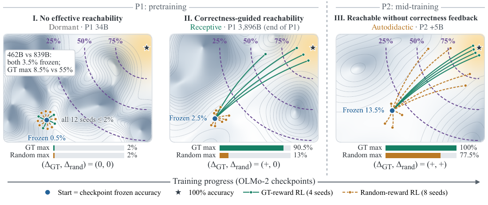

# Probe with Participation Trophies: Random-Reward RL as a Probe of LLM Capability

Yu Mao, Lei Yu, Zining Zhu, Yusheng Zheng, Haohang Li, Freda Shi, Yutong Yin, Zhaoran Wang, Jingcheng Niu

[](https://arxiv.org/abs/2610.01066)

Code and data for the paper.

<p align="center"></p>

Random rewards can improve LLMs under RL. We read this as a probe of **reachability**: what further training can
attain from a checkpoint under fixed constraints, beyond its current accuracy. Because a random reward carries no
information about which answers are correct, random-reward RL measures what training can attain without
correctness feedback.

Scanning OLMo-2-7B checkpoints across pre-training (P1) and mid-training (P2) on synthetic arithmetic shows three regimes:

| Regime | Checkpoints | GT-reward RL | Random-reward RL |
|---|---|---|---|
| Dormant | early P1 | little gain | little gain |
| Receptive | late P1 | large gain | little gain |
| Autodidactic | P2 | large gain | large gain in some seeds |

## Installation

```bash
python3 -m venv .venv && source .venv/bin/activate
pip install -r requirements.txt
```

Every run fits on one 80 GB GPU (7B model, LoRA r=8). Weights are downloaded from Hugging Face at run time by pinned
revision. Optional environment variables: `PROBE_PYTHON` (interpreter written into job files, default `python3`),
`PROBE_OUT` (run root, default `./runs`), `PROBE_HF_HOME` (Hugging Face cache), `HTTP_PROXY`.

CPU checks, a few seconds each:

```bash
cd src
(cd trainer && python test_protocol.py)
(cd checkpoint_scan && python test_contract.py)
(cd shared_rollout && python test_shared_rollouts.py)   # needs torch
```

## Quick start: one run

GT vs. random reward at the first mid-training checkpoint (P2 +5B), 500 updates, about 40 minutes on one H100:

```bash
cd src
python trainer/rlvr_probe_v2_fixedsplit.py \
  --dataset_path data/synthetic_gsm_rlvr_1000_seed13.jsonl --output_dir ../runs/quickstart \
  --base_model allenai/OLMo-2-1124-7B --revision stage2-ingredient1-step1000-tokens5B \
  --train_mode original --reward_mode random --kl_coeff 0.01 \
  --seed 31001 --split_seed 777 --train_steps 500 --group_size 4 --max_new_tokens 96 \
  --learning_rate 3e-5 --eval_every 100 --eval_limit 200 --eval_batch_size 8 \
  --lora_r 8 --lora_alpha 16 --lora_dropout 0
```

Use `--reward_mode ground_truth --kl_coeff 0` for the GT arm. A run writes one JSONL file whose records have
`phase` ∈ {`meta`, `before`, `train`, `eval`, `after`}; `eval` holds held-out greedy accuracy every 100 steps.

## Reproducing the paper

Each `gen_jobs.py` writes `jobs.jsonl`, a manifest and a Slurm array script into its run root, then prints the
`sbatch` line. It never submits anything and refuses to overwrite an existing job list. Run the commands below from `src/`.

| Paper | Experiment | Code |
|---|---|---|
| §3, App. E.7 | Shared rollouts: P1 and P2 learners trained on identical rollouts and rewards | `shared_rollout/` |
| §3, App. D.3, E.5–E.6 | Training-input controls A–E (OLMo-2, Qwen2.5, Llama-3.1) | `input_controls/` |
| Fig. 1, §5, App. D.2, E.1 | OLMo-2 checkpoint scan on synthetic GSM: 37 checkpoints × {frozen, GT, Random} | `checkpoint_scan/`, `checkpoint_curve/` |
| App. D.4, E.3 | SmolLM2-1.7B and OLMo-3-7B checkpoints | `cross_model/` |
| App. D.5, E.8 | Group size and early steering (`gt_K50`, `anti_K50`) | `rlvr_probe_v2.py` |

**Shared rollouts (§3).** Frozen P1 and P2 checkpoints each generate a rollout stream, and both learners are trained
off-policy on each stream (2 × 2 cells, 16 replicates).

```bash
python shared_rollout/gen_jobs.py --root ../runs/shared_rollout --phase smoke   # 2 tasks, 20 steps
python shared_rollout/gen_jobs.py --root ../runs/shared_rollout --phase main    # 32 tasks, 500 steps
python shared_rollout/summarize_shared_rollouts.py ../runs/shared_rollout     # tables, paired tests, figures
```

**Training-input controls (§3).** Random rewards at P2 +50B, with the GSM question replaced by a shuffled question (C),
an MMLU stem (A), random tokens inside the math template (D) or random tokens alone (E). Evaluation always uses real GSM questions.

```bash
python input_controls/gen_jobs.py --tag p2_50B --arms C A --seeds 31001 31016 --out ../runs/input_controls_CA
python input_controls/gen_jobs.py --tag p2_50B --arms D E --seeds 31001 31032 --out ../runs/input_controls_DE
python input_controls/gen_jobs.py --tag qwen25_7b llama31_8b --arms D E --seeds 31001 31008 --out ../runs/input_controls_xmodel
```

**Checkpoint scan (§5).** `configs/olmo2_checkpoints.json` pins the 25 P1 and 12 P2 revisions with their commit SHAs.

```bash
python checkpoint_curve/gen_jobs.py --out ../runs/checkpoint_curve           # frozen + GT + Random jobs
python checkpoint_curve/plot_three_scores.py ../runs/checkpoint_curve --out three_scores.png
```

**Other model families (appendix).**

```bash
python cross_model/gen_jobs.py --out ../runs/cross_model --phase frozen      # then --phase smoke, --phase rl
python cross_model/summarize.py ../runs/cross_model
```

**Group size and early steering (appendix).** `rlvr_probe_v2.py` is the earlier trainer with the same update rule. It
adds `--steer_steps K --steer_reward_mode {ground_truth,anti_gt}`, which gives correctness rewards for the first K
steps and random rewards afterwards. Its train/eval split follows `--seed` and `--train_frac`, as in that study.

```bash
python rlvr_probe_v2.py --dataset_path data/synthetic_gsm_rlvr_1000_seed13.jsonl --output_dir ../runs/steer \
  --base_model allenai/OLMo-2-1124-7B --revision stage2-ingredient1-step1000-tokens5B \
  --reward_mode random --steer_steps 50 --steer_reward_mode anti_gt --group_size 8 \
  --kl_coeff 0.01 --learning_rate 3e-5 --train_steps 500 --eval_every 100 --max_new_tokens 96 --seed 777
```

The same script takes `--task_type code` for MBPP (`code_eval.py` executes each solution with a 10 s timeout).

## Data

All data are in `src/data/`.

| File | Contents |
|---|---|
| `synthetic_gsm_rlvr_1000_seed13.jsonl` | 1,000 template arithmetic problems (800 train / 200 eval with split seed 777), from `make_synth_gsm.py` |
| `randq_C_shuffled_gsm.jsonl` | C: words shuffled within each GSM question |
| `randq_A_mmlu.jsonl` | A: digit-free MMLU question stems, length-matched |
| `randq_D_randtok.jsonl` | D: random vocabulary tokens in the math template |
| `randq_E_rawtok.jsonl` | E: random tokens used as the whole prompt |
| `mbpp_rlvr_964.jsonl` | MBPP, 964 problems, from `create_mbpp_dataset.py` |

`input_controls/build_datasets.py` and `build_dataset_E.py` rebuild the control sets. Rebuilding A needs an MMLU dump
at `data/mmlu_all.jsonl`, which is not included.

## Repository layout

```
configs/olmo2_checkpoints.json   pinned OLMo-2 revisions, SHAs and training protocol
src/
  trainer/            on-policy GRPO trainer used by every run, frozen evaluation (greedy + 32 samples), split protocol
  checkpoint_scan/    worker and manifest for the 37-checkpoint OLMo-2 scan
  checkpoint_curve/   job generator and three-line figure (frozen / GT max / Random max)
  input_controls/     builders and job generator for controls A–E
  shared_rollout/     rollout caching, off-policy learner, audit, summary, CPU tests
  cross_model/        SmolLM2 / OLMo-3 jobs and summary
  rlvr_probe_v2.py    earlier trainer with steering and code support
  probe_checkpoints.py  data loading, prompts, answer extraction (lenient and strict `#### <number>`)
  data/
```

## Notes

- **Protocol.** LoRA r=8, α=16 on q, k, v, o, gate, up and down projections; lr 3e-5; group size 4; 500 updates;
  96 new tokens; temperature 1, top-p 0.95. GT uses reference coefficient 0, Random uses 0.01 with Bernoulli(0.5)
  rewards. Rewards are standardized within each group.
- **Scoring.** The lenient extractor looks for `####`, then an annotated equation, then an answer phrase, then falls
  back to the last number in the output. Base checkpoints that keep writing after the answer therefore score low. The
  strict extractor accepts only `#### <number>`.
- **Determinism.** GPU runs in BF16 are not bit-reproducible, so every gain is computed against the run's own step-0 score.

## Citation

```bibtex
@article{mao2026probe,
  title   = {Probe with Participation Trophies: Random-Reward {RL} as a Probe of {LLM} Capability},
  author  = {Mao, Yu and Yu, Lei and Zhu, Zining and Zheng, Yusheng and Li, Haohang and Shi, Freda and Yin, Yutong and Wang, Zhaoran and Niu, Jingcheng},
  journal = {arXiv preprint arXiv:2610.01066},
  year    = {2026}
}
```
